# 國中三視圖教材修正（2026-10-24）

範圍：`orthographic/` 五個模組。依據兩個模型（Gemini 3.8 Flash、Claude Sonnet 5.5）獨立檢查、再經人工核對的結果修正。
全站教的是 CNS **第三角法**：俯視在正視上方（俯視下緣＝物體前方）、右側視在正視右方（右側視左緣＝物體前方）。
標準答案一律以 `models/orthographic/*.scad` 的實際立體為準（OpenSCAD 的 -Y 是正面，和模組 4 的 3D 視窗一致）。

## 一、修正內容

### 1. 模組 5 第 3 關（方塊堆疊）投影方向

- **修正前**：`drawSilhouette` 對每個視圖都把列上下反轉，所以俯視圖前後顛倒（前緣畫在上方，等於仰視）；`projectGrid('side')` 用 `out[y][z]`，畫出來的是左側視（前方在右）。T 形塊的目標俯視圖因此變成倒 T（⊥）。
- **修正後**：`projectGrid` 直接回傳畫面方向的陣列（第 0 列畫在最上面），和 3D 相機（在 +Z 前方）一致：
  - 正視：x 向右、y 向上
  - 俯視：x 向右，後方（z=0）在上、前緣在下
  - 右側視：前方在左、後方在右、y 向上
  `drawSilhouette` 不再反轉。目標用方塊座標定義，三視圖由 `projectGrid` 算出，所以判分自動跟著新方向。
- 第 3 關的縮圖標籤「側視」改為「右側視」。

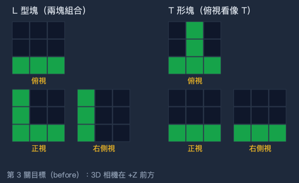
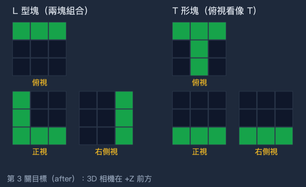

### 2. 模組 5「放棄後永遠不能過關」

`gaveUp` 原本只在按「自動完成（放棄）」時設成 true，按「清空」不會重置，所以放棄後自己重新堆對也永遠不算過關。
現在 `clearAll()` 會把 `gaveUp` 設回 false；`fillTarget()` 先清空再設 `gaveUp = true`。

### 3. 模組 5 第 1、2 關的標準視圖（SHAPES／svgView）

每個立體改用模型的實際比例。三個視圖用同一比例尺，各自置中在同尺寸方格裡，所以排成第三角法時自然「長對正、高平齊、寬相等」。
特徵線分三種，以 `data-k` 標示（給測試用）：可見線（實線）、隱藏線（虛線）、中心線（細鏈線）。

| 立體 | 修正前 | 修正後 |
|---|---|---|
| L 型塊（90×40×60） | 右側視是空白矩形，漏畫高低交界的可見線 | 俯視有垂直分界線（和正視內角長對正），右側視有水平分界線（和正視內角高平齊） |
| 階梯塊（80×40×60） | 俯視、右側視都是空白矩形；正視和 L 型塊用同一張圖 | 正視上層佔一半寬；俯視、右側視都畫出分界線，和模組 1、首頁主圖一致 |
| 帶圓孔板（80×50×50，Ø36） | 虛線固定在中心 ±8px，不等於孔徑、不隨尺寸縮放；右側視寬度 ≠ 俯視深度 | 虛線間距＝孔徑並隨尺寸縮放；右側視改為正方形（深 50 × 高 50）；三視圖都加中心線 |
| T 槽塊（80×30×60） | 正視是實心 T、俯視是倒 T，和模型不符；正視和側視不等高 | 依模型：俯視畫出 T 形槽口（橫槽在後並穿出背面），正視、右側視以虛線畫出槽壁與槽底（槽深一半）；正視和側視等高 |
| L 角架（60×60×40） | 右側視漏畫可見線；正視漏畫內角隱藏線 | 俯視 L 形（腳厚 1/4，豎腳在左、橫腳在前）；正視有內角虛線；右側視有前腳交界的實線 |

| 修正前 | 修正後 |
|---|---|
| 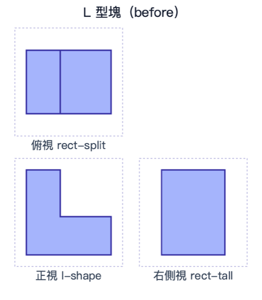 | 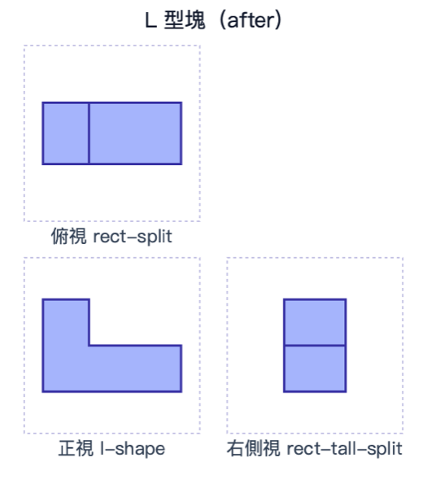 |
| 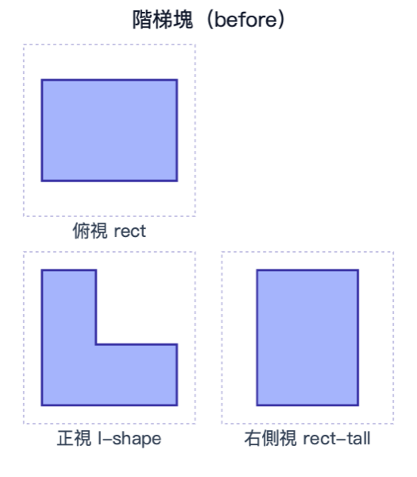 | 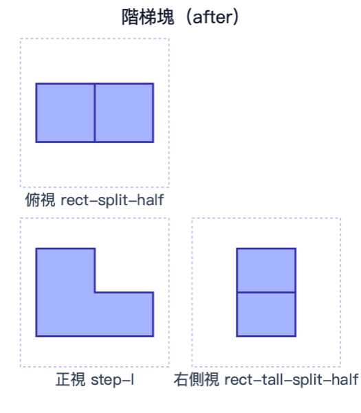 |
| 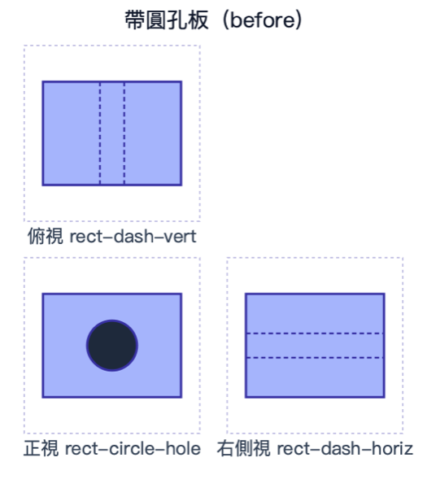 | 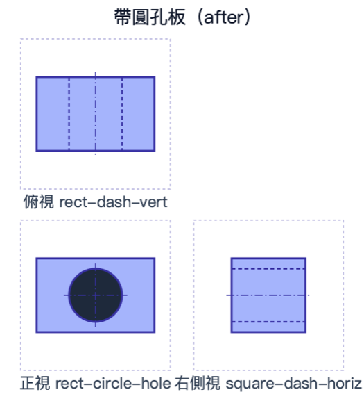 |
| 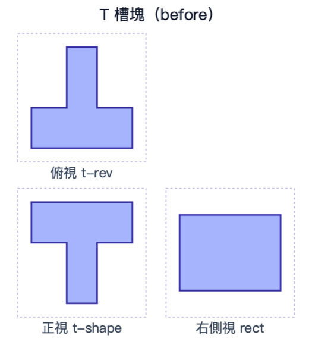 | 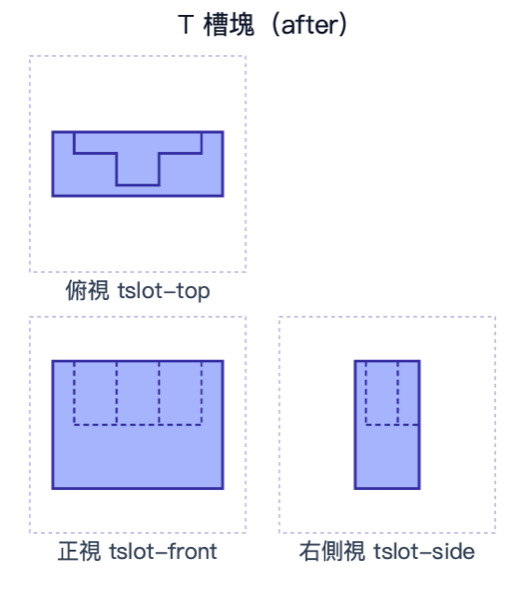 |
| 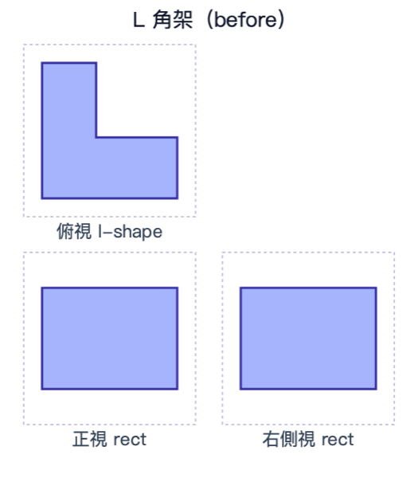 | 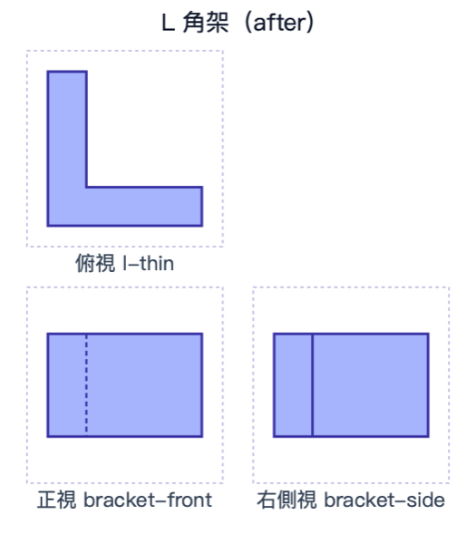 |

題目和答案：第 1 關 L 型塊、帶圓孔板的題目視圖與解析，以及第 2 關 L 型塊的已知視圖與解析，都已同步更新。測試確認每題仍然只有一個正確選項（見第二節）。

### 4. 模組 5 第 1、2 關改成第三角法排列

原本三個視圖排成一列（正→側→俯）。現在改用 2×2 格：俯視在左上、正視在左下、右側視在右下，右上角放「第三角法」提示。
兩欄寬度相同，所以俯視和正視上下對齊、正視和右側視左右對齊。第 2 關的 3D 縮圖和視圖組在窄螢幕會自動換行。
在 320px 寬時，視圖區約佔 210px，放得下。
另外修好原本就有的問題：手機上四個選項會超出卡片，現在寬度 ≤520px 時改成兩欄，圖片也會跟著縮小。

| iPhone 模擬器：第 1 關 | 選項列 |
|---|---|
| 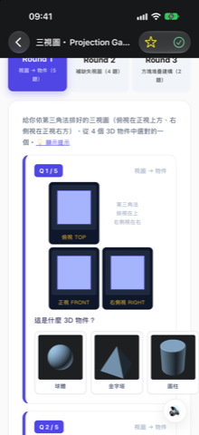 | 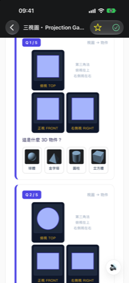 |

### 5. 文字修正

- **模組 4 INFOS**：L 型塊（補上兩條分界線）、T 槽塊（改成符合模型：T 形槽、深一半、橫槽穿出背面；正視和側視用虛線）、L 角架（截面沿**高度**方向延伸，不是沿深度；並寫出正視虛線、側視實線）。檔頭與 `aimOrthoCamera` 註解中錯誤的相機方向也一併更正。
- **模組 2**：刪除等角圖「透視假象」的說法，改成「軸線斜 30°、圓變橢圓；它是平行投影（軸測投影），沒有近大遠小」。「斜視圖 Oblique」改名為「斜投影圖 Oblique」，並註明有些課本稱「斜視圖」，而製圖上的斜視圖另指輔助視圖。「三視圖（正投影）」改為「三視圖（多視正投影）」，避免讓人以為等角圖不是正投影。「製造業唯一能精確標尺寸」改成較不絕對的說法。
- **模組 3 步驟 5**：刪除「（或左方）」。提示改為「第三角法慣用右側視圖；若改畫左側視圖，要畫在正視的左方」。
- **模組 1 剖視圖**：補上俯視圖與 A-A 剖切線（粗鏈線，箭頭指向觀看方向）。剖視圖標成「剖視 A-A」；孔上下貫通，所以孔的位置上下都不畫輪廓線；切到的材料畫 45° 剖面線，並補上中心線。
- **未修改**：「台灣、美國、日本慣用第三角法」維持原文（JIS B 0001:2019 規定第三角法）。

| 修正前 | 修正後 |
|---|---|
| 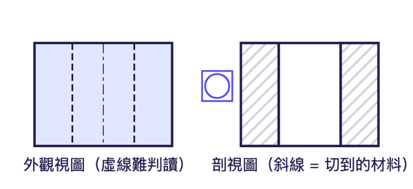 | 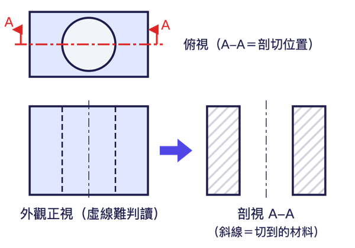 |

### 6. 部署與題庫

- 快取版本：`module1.js?v=2`、`module2.js?v=3`、`module3.js?v=3`、`module4.js?v=2`、`module5.js?v=3`。本站以查詢字串版本號更新快取，沒有 deploy.yml 清單，也沒有 dev-log、CHANGELOG。
- `assets/sheet-items.json`（老師試算表題庫）：模組 2 的 8 題選項名稱，以及模組 5 第 1 關 5 題、第 2 關第 1 題的題幹改了，所以依 `tools/sheets/build_items.py` 的 `q_hash` 重算指紋，版本日期改為 2026-10-23。
  原本的 `build_items.py` 要開 Chrome（Playwright），這次沒有跑。新題幹由測試用的同一份抽出程式算出；其他沒改的題目，Python 重算的指紋和原值全部相同。

## 二、驗證

新增 `orthographic/tests/`（用 Node 內建測試，執行 `node --test orthographic/tests/`）：

- `_extract.mjs`：從 `module5.js` 抽出純邏輯宣告（SHAPES、svgView、projectGrid、ROUND1–3 等），放進 vm 執行。測試的就是實際上線的程式碼，不載入 three.js。
- `projection.test.mjs`（6 項）：L 型塊、T 形塊目標的正視、俯視、右側視 3×3 期望值；單一方塊的方向；隨機位置的長對正、高平齊、寬相等；兩個目標的解答唯一（在三視圖都亮的格子裡窮舉）；放棄後清空可以恢復計分。
- `views.test.mjs`（10 項）：所有用到的視圖類型都畫得出來；每個立體在 80、90、160 三種尺寸下都長對正、高平齊、寬相等，而且置中；L 型塊和階梯塊的分界線和正視內角對齊；孔的虛線間距＝孔徑並隨尺寸縮放；角架、T 槽塊的特徵線位置與跨視圖對齊；第 1 關的題目視圖和 SHAPES 一致，選項中只有答案的三視圖相同；第 2 關四個選項畫出來都不同，而且恰有一個正確。
- `render_views.mjs`：輸出本報告的前後對照圖（SVG 用 cairosvg 轉 PNG，沒有開 Chrome）。

結果：**16／16 通過**；所有改過的 JS 都通過 `node --check`。

視覺檢查：由 Antigravity（Gemini 3.8 Flash）讀前後對照圖，每張圖回答 2–4 題是非題，模型事先不知道期望答案。
修正後 7 張全部符合期望（20／20 題），修正前 7 張都有不符合的項目，紀錄在 `三視圖修正_2026-10-24/vlm_result.json`。
另外在 iPhone 模擬器（暫時替換 App 內的檔案，拍完已還原）確認第 1 關的第三角法排列和選項列。人工看過的圖：T 槽塊、剖視圖、兩張模擬器截圖。

## 三、待決定

1. **線型粗細 0.5／0.35／0.18 mm**（模組 1 概念 4、模組 3 步驟 7）：CNS 3 常見的粗、中、細比例是約 2:1 的級距（如 0.5／0.25／0.13 或 0.7／0.35／0.18）。教材採用哪一版 CNS 需要確認，這次沒有修改。
2. 第 3 關的 L 型塊目標全部在最後一排（z=0）。修正後投影正確，但學生得把方塊堆在離鏡頭最遠的那一排；要不要把目標移到前排，可以再決定。
3. 第 3 關仍然只比對 3×3 剪影（不比對可見線），而且空盤時就有 50–60% 的「相似度」。目前兩個目標的解答唯一，判分正確；之後新增目標時要跑 `projection.test.mjs` 的唯一性檢查。
4. 等角預覽 PNG 沒有重新算圖（模型沒有改）。
5. 高中 PC13110 三視圖頁的「只有剪影」問題不在這次範圍內。
